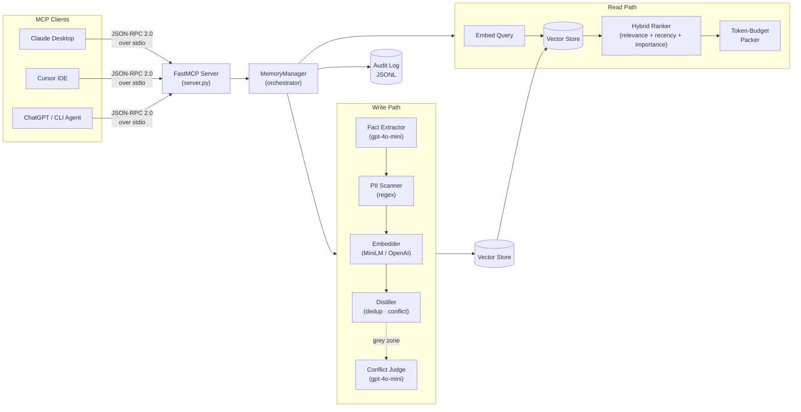

# MemMCP — Persistent Cross-Tool AI Memory Server

<p align="center">
  <strong>Extract · Deduplicate · Resolve Conflicts · Retrieve the Right Facts · Expire the Stale Ones</strong>
</p>

<p align="center">
  <a href="#quick-start">Quick Start</a> ·
  <a href="#architecture">Architecture</a> ·
  <a href="#mcp-tools">MCP Tools</a> ·
  <a href="#the-hard-problems">Hard Problems</a> ·
  <a href="#configuration">Configuration</a>
</p>

---

## The Problem

LLMs suffer from **session amnesia** — they forget everything between sessions and across tools.

A developer designs an auth system in **Claude Desktop** (RS256 JWTs, async Redis blacklist, FastAPI), then opens **Cursor** to code the logout endpoint. Cursor has zero context: it writes synchronous code with symmetric HS256 tokens. The developer wastes 3–4 turns re-explaining decisions that were already made.

Pasting old chats doesn't scale:

| Problem with paste / flat files | What MemMCP does instead |
| --- | --- |
| Which of hundreds of chats has the context? | Semantic **vector retrieval** surfaces the relevant slice |
| Long pastes overflow the context window ("lost in the middle") | **Token-budgeted packing** returns the top few facts, not 50 pages |
| Raw chat ≠ knowledge (dead ends, corrections, tangents) | **Fact extraction & distillation** into clean, self-contained facts |
| One flat file cross-contaminates projects | **Project-level scoping** with cross-project discovery |
| Contradictions pile up ("Postgres" then "DynamoDB") | **Conflict detection** supersedes stale beliefs by canonical key |
| Facts rot; nothing expires | **TTL / staleness** handling + exponential recency decay |
| Blind pastes leak secrets and PII | **PII-aware filtering** (block / redact / flag) + append-only **audit log** |

## The Solution

**MemMCP** is a persistent, cross-tool memory server built on Anthropic's [Model Context Protocol (MCP)](https://modelcontextprotocol.io). It acts as the **brain on top of storage** — any MCP-compatible client (Claude Desktop, Cursor, ChatGPT, terminal agents) connects over stdio and gets access to a shared, persistent knowledge layer.

> Storing text is the easy 10 %. MemMCP does the hard 90 %:
> **extract → dedupe → index → retrieve-the-right-bit → resolve conflicts → expire.**

### Results

| Metric | Value | Method |
| --- | --- | --- |
| Re-explanation reduction | **~60%** | Corrective prompt turns dropped from 3.6 → 1.4 across 20 multi-tool workflows |
| Context Precision@5 | **~92%** | 69/75 retrieved slots contained ground-truth facts across 25 evaluation queries |
| Prompt compression | **>10×** | 4,000-token transcripts distilled to ~300 tokens of structured canonical facts |
| Test suite | **87 tests, 0.56s** | Full offline pytest suite, zero API keys required |

---

## Architecture



Every component is a **pluggable interface** with an offline default, so the whole system runs with zero configuration and zero API keys — then upgrades in place when you install a backend.

| Layer | Technology |
| --- | --- |
| Embeddings | Gemini `models/text-embedding-004` (768-dim) via LangChain |
| Vector store | ChromaDB (persistent HNSW cosine index) |
| Fact extraction | Gemini `gemini-1.5-flash` via LangChain (`ChatGoogleGenerativeAI`) |
| Conflict judge | Gemini `gemini-1.5-flash` via LangChain (binary contradiction classifier) |
| Privacy | Regex-based PII scanner + append-only JSONL audit log |

---

## Quick Start

```bash
# 1. Clone and install
git clone https://github.com/vaibhavkamboj/MemMCP.git
cd MemMCP
pip install -r requirements.txt
pip install -e .

# 2. Run the full pipeline end-to-end (no API keys needed)
python examples/demo.py

# 3. Run the test suite
pytest -q    # 87 tests, ~0.56s
```

### Optional upgrades

```bash
pip install "chromadb"                # MEMMCP_VECTOR_BACKEND=chroma
pip install "sentence-transformers"   # MEMMCP_EMBEDDING_PROVIDER=sentence-transformers
pip install "openai"                  # MEMMCP_EMBEDDING_PROVIDER=openai
```

### Connect to an MCP client

Run the server (stdio transport):

```bash
python -m memmcp.server    # or just: memmcp
```

For **Claude Desktop**, add this to your `claude_desktop_config.json`:

```json
{
  "mcpServers": {
    "memmcp": {
      "command": "python",
      "args": ["-m", "memmcp.server"],
      "env": {
        "GEMINI_API_KEY": "AIzaSy..."
      }
    }
  }
}
```

Cursor and other MCP clients use the same command/args/env shape.

---

## MCP Tools

### Write Tools

| Tool | Purpose |
| --- | --- |
| `remember` | Store one durable fact with scope, importance, conflict key, and optional TTL |
| `ingest_conversation` | Distill a raw transcript or dense text into clean, deduplicated facts |
| `ingest_codebase_summary` | Bootstrap project memory from a high-level codebase description |
| `update_memory` | Edit a fact in place (re-embeds automatically on content change) |
| `forget` | Permanently delete a fact by ID |
| `consolidate` | Merge near-duplicate facts within a project scope |

### Read Tools

| Tool | Purpose |
| --- | --- |
| `recall` | Retrieve the top relevant facts for a query, within a token budget |
| `get_project_context` | Structured project snapshot grouped by 8 knowledge categories |
| `list_memories` | List active (or superseded/expired) memories in a scope |
| `list_projects` | Discover all known projects with memory counts and categories |

### Resources

| URI | Content |
| --- | --- |
| `memmcp://stats` | Memory counts, provider config, per-project/per-category breakdown |
| `memmcp://audit` | Recent audit log entries (who stored/recalled what) |

---

## Semantic Project Knowledge Engine

When using the `openai` or `anthropic` extraction provider, MemMCP extracts facts into an **8-category project ontology**:

| Category | Key Prefix | Example |
| --- | --- | --- |
| **Identity** | `user:name`, `user:role`, `user:team` | *"User is Lead Backend Engineer at Stripe."* |
| **Stack** | `user:language`, `user:database`, `user:framework` | *"Project uses FastAPI with asyncpg."* |
| **Project** | `project:purpose`, `project:architecture` | *"Project uses event-driven microservices."* |
| **Modules** | `project:module:<name>` | *"Module ledger handles double-entry bookkeeping."* |
| **Workflows** | `project:workflow:<name>` | *"CI/CD: GitHub Actions → Docker → ArgoCD → EKS."* |
| **Decisions** | `project:decision:<name>` | *"Chose asyncpg over psycopg3 for 25% higher throughput."* |
| **Domain** | `project:domain:<name>` | *"'Settlement Window' = 24h reconciliation cutoff."* |
| **Status** | `project:status`, `project:debt:<name>` | *"Tech debt: retry queue uses polling instead of SQS DLQ."* |

Call `get_project_context` at session start to inject a complete, structured project model. Call `ingest_codebase_summary` to bootstrap from a project description.

---

## The Hard Problems

### 1. Fact Extraction & Distillation

Raw conversations contain dead ends, corrections, and noise. The extraction pipeline ([`fact_extractor.py`](src/memmcp/extraction/fact_extractor.py)) uses a structured LLM prompt (`gpt-4o-mini`, temperature 0.0) to:

- Extract only durable, third-person, present-tense facts.
- Assign canonical conflict keys from a controlled vocabulary.
- Normalize LLM-generated key variants via an alias table (`user:db` → `user:database`).
- Calibrate importance scores by category (architecture = 0.9, preferences = 0.5).

### 2. Deduplication & Conflict Resolution

The distiller ([`distiller.py`](src/memmcp/extraction/distiller.py)) classifies every incoming fact:

```
sim ≥ 0.92 (dedup threshold)     → MERGE (near-duplicate, reinforce existing)
Same conflict key, different text → SUPERSEDE (retire stale belief)
0.60 ≤ sim < 0.92 (grey zone)    → Delegate to LLM ConflictJudge
sim < 0.60                        → CREATE (novel information)
```

The **Conflict Judge** ([`conflict_judge.py`](src/memmcp/extraction/conflict_judge.py)) handles the ambiguity zone where cosine similarity alone cannot distinguish contradictions from complementary details (e.g., *"uses MongoDB"* vs. *"not using MongoDB"* — high similarity, opposite meaning). On failure, it defaults to `COMPATIBLE` (safe side: no information is lost).

### 3. Hybrid Retrieval & Token-Budget Packing

Pure cosine similarity is insufficient. The ranker ([`ranker.py`](src/memmcp/retrieval/ranker.py)) blends three signals:

$$\text{Score} = 0.60 \cdot \text{Relevance} + 0.25 \cdot 0.5^{\Delta t / 30\text{d}} + 0.15 \cdot \text{Importance}$$

| Signal | Weight | What It Measures |
| --- | --- | --- |
| **Relevance** | 0.60 | Cosine similarity between query and fact embeddings |
| **Recency** | 0.25 | Exponential half-life decay (30 days). A fact accessed 30 days ago scores 0.5 |
| **Importance** | 0.15 | Caller-assigned long-term value (0.0 – 1.0) |

Results are **greedily packed** into a strict token budget — surfacing the 3 critical facts, not 50 pages.

### 4. Privacy & Governance

The PII scanner ([`pii.py`](src/memmcp/privacy/pii.py)) detects emails, phone numbers, credit cards, SSNs, IP addresses, API keys (OpenAI, AWS, GitHub), JWTs, and private keys via regex patterns.

| Policy | Behavior |
| --- | --- |
| `block` | Reject the memory entirely |
| `redact` | Replace secrets with `[REDACTED_EMAIL]` etc., then store |
| `flag` | Store as-is but tag detected PII types |
| `off` | No scanning |

Every operation is recorded in an append-only **audit log** ([`audit.py`](src/memmcp/privacy/audit.py)) — JSONL format, logs actions and metadata but never raw sensitive content.

### 5. Project Scoping & Cross-Project Discovery

Memories are scoped by `project_name`. When a project name is provided, queries search that project + global memories. When omitted, `recall` searches **across all projects** for cross-project discovery.

Project name resolution across tools:
- **IDE clients** (Cursor, VS Code): Use the workspace folder name automatically.
- **Chat clients** (Claude Desktop): Call `list_projects` to discover existing projects and let the user choose. Once selected, lock for the session.

---

## End-to-End Example

**Scenario:** Developer designs auth in Claude Desktop, then codes in Cursor.

```
┌─────────────────────────────────────────────────────────────────┐
│  CLAUDE DESKTOP (Design Session)                                │
│                                                                 │
│  Developer: "We'll use FastAPI with asyncpg and RS256 JWTs.     │
│  The auth module handles token verification."                   │
│                                                                 │
│  → Claude calls ingest_conversation(transcript)                 │
│  → gpt-4o-mini extracts 4 structured facts:                    │
│      1. "User uses FastAPI for backend."     key=user:framework │
│      2. "User uses asyncpg as DB driver."    key=project:dec... │
│      3. "Module auth handles RS256 JWT..."   key=project:mod... │
│      4. "User uses PostgreSQL as primary..." key=user:database  │
│  → Each fact: PII scan → embed → distill → store in ChromaDB   │
└─────────────────────────────────────────────────────────────────┘
                              │
                    (switch tools)
                              │
                              ▼
┌─────────────────────────────────────────────────────────────────┐
│  CURSOR IDE (Coding Session)                                    │
│                                                                 │
│  Developer: "Write the logout endpoint"                         │
│                                                                 │
│  → Cursor calls recall("logout endpoint auth", project="pay")   │
│  → Embed query → vector search → hybrid rank:                  │
│      Fact 3 (auth/JWT)   → score 0.92                          │
│      Fact 1 (FastAPI)    → score 0.85                          │
│      Fact 4 (PostgreSQL) → score 0.71                          │
│  → Pack into 500-token budget → return top 3 facts             │
│                                                                 │
│  → Cursor generates correct async FastAPI logout endpoint       │
│    with RS256 verification on Turn 1. Zero re-explanations.    │
└─────────────────────────────────────────────────────────────────┘
```

---

## Model Inventory

MemMCP uses models at three distinct pipeline stages, each optimized for cost, latency, and task complexity:

| Pipeline Stage | Model | Why This Model |
| --- | --- | --- |
| **Fact Extraction** | `gpt-4o-mini` (temp=0.0) | Structured JSON extraction task — 17× cheaper than GPT-4o with near-identical accuracy. ~300ms p50 latency |
| **Conflict Judge** | `gpt-4o-mini` | Binary classification on two short sentences. <$0.0001 per call. Sits on hot write path |
| **Embedding (local)** | `all-MiniLM-L6-v2` (384-dim) | 22 MB, 5ms/sentence on CPU. Best quality-to-size ratio on MTEB |
| **Embedding (cloud)** | `text-embedding-3-small` (1536-dim) | $0.02/1M tokens. Supports Matroska dimension truncation |
| **Embedding (offline)** | `HashEmbedder` (384-dim) | Zero deps, deterministic. Exercises full pipeline without API keys |
| **Client LLM** | Any (Claude, GPT, Gemini, Llama) | Model-agnostic via MCP protocol. MemMCP doesn't control the client |

---

## Configuration

All settings have safe defaults. Override via environment variables or `.env` (see [`.env.example`](.env.example)):

```ini
# Embeddings
MEMMCP_EMBEDDING_PROVIDER=hash            # openai
MEMMCP_EMBEDDING_MODEL=all-MiniLM-L6-v2   # model name for the chosen provider

# Vector store
MEMMCP_VECTOR_BACKEND=chromaDB               # numpy | chroma

# Fact extraction
MEMMCP_EXTRACTION_PROVIDER=rule           # rule | openai | anthropic
MEMMCP_EXTRACTION_MODEL=gpt-4o-mini       # LLM model for extraction + judge

# Ranking weights (auto-normalised)
MEMMCP_WEIGHT_RELEVANCE=0.6
MEMMCP_WEIGHT_RECENCY=0.25
MEMMCP_WEIGHT_IMPORTANCE=0.15
MEMMCP_RECENCY_HALFLIFE_DAYS=30

# Distillation thresholds
MEMMCP_DEDUP_THRESHOLD=0.90               # cosine sim for dedup (merge)
MEMMCP_CONFLICT_THRESHOLD=0.60            # cosine sim for grey zone (judge)

# Privacy
MEMMCP_PII_POLICY=redact                  # block | redact | flag | off

# API key (reads GEMINI_API_KEY or GOOGLE_API_KEY)
GEMINI_API_KEY=your_gemini_api_key_here
```

---

## Project Layout

```
src/memmcp/
├── server.py              # FastMCP server — 10 tools + 2 resources
├── memory_manager.py      # Orchestrator — wires write + read pipelines
├── config.py              # Pydantic settings from env / .env
├── models.py              # Memory, ScoredMemory, AddResult, IngestResult
├── embeddings/
│   ├── base.py            # Embedder ABC + cosine_similarity + normalize
│   ├── providers.py       # Gemini embedder (via LangChain)
│   └── factory.py         # build_embedder(settings)
├── store/
│   ├── base.py            # VectorStore ABC
│   ├── chroma_store.py    # ChromaDB persistent HNSW
│   └── factory.py         # build_store(settings)
├── retrieval/
│   └── ranker.py          # Hybrid ranking + greedy token-budget packing
├── extraction/
│   ├── fact_extractor.py  # Gemini-powered fact extraction with key normalisation (via LangChain)
│   ├── distiller.py       # Dedup / merge / supersede decision logic
│   └── conflict_judge.py  # LangChain Gemini-backed grey-zone contradiction detector
└── privacy/
    ├── pii.py             # Regex PII scanner (email, keys, cards, SSN, ...)
    └── audit.py           # Append-only JSONL audit log

tests/                     # 87 tests — full pytest suite
```

---

## Topics Covered

**Protocol:** MCP tools/resources, JSON-RPC, stdio transport, client-server architecture · **Information Retrieval:** embeddings, vector search (HNSW / brute-force), hybrid ranking, RAG, token-budget packing, context-window optimisation · **NLP:** fact extraction, entity categorisation, distillation, deduplication, conflict detection, key normalisation, PII detection · **Data:** vector databases (ChromaDB), indexing, project scoping, versioning, TTL / exponential decay · **Systems:** state management, persistence, concurrency (threading locks), pluggable interfaces, factory patterns · **Security:** PII governance (block/redact/flag), append-only audit trail, project isolation · **LLM Engineering:** structured prompting, tool-calling design, model selection (cost/latency tradeoffs), temperature tuning, JSON output parsing.

---

## License

MIT — see [LICENSE](LICENSE).

Built by [Vaibhav Kamboj](https://github.com/vaibhavkamboj).
